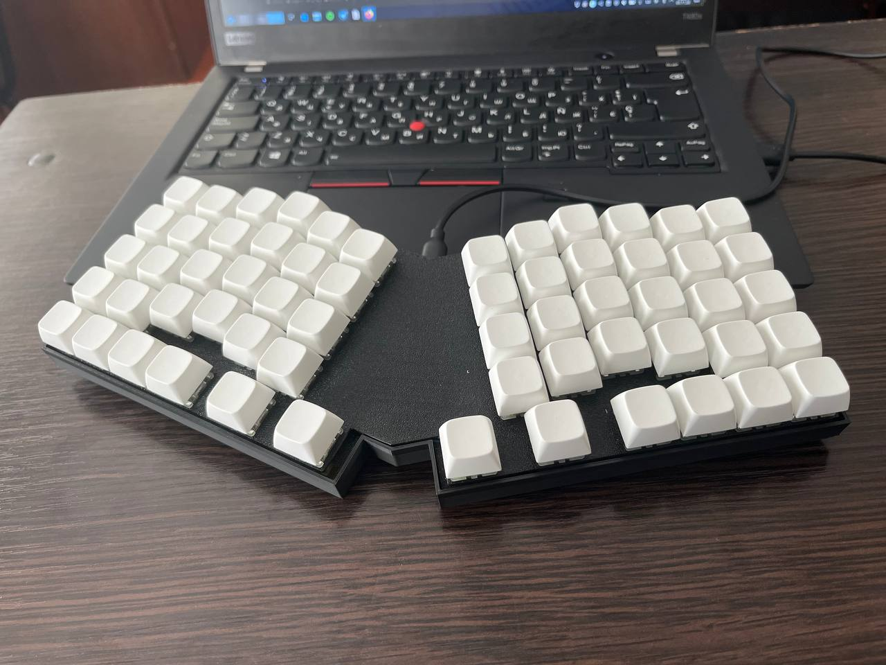

# sauln_arx

*pico OnePiece-ortholinear keyboard*

* Hardware Supported: *raspberry pi pico, Cherry MX switches*

See the [build environment setup](https://docs.qmk.fm/#/getting_started_build_tools) and the [make instructions](https://docs.qmk.fm/#/getting_started_make_guide) for more information. Brand new to QMK? Start with our [Complete Newbs Guide](https://docs.qmk.fm/#/newbs).

## Bootloader

Enter the bootloader in 3 ways:

* **Bootmagic reset**: Hold down the key at (0,0) in the matrix (usually the top left key or Escape) and plug in the keyboard
* **Physical reset button**: Briefly press the button on the back of the PCB - some may have pads you must short instead
* **Keycode in layout**: Press the key mapped to `QK_BOOT` if it is available

## Assembly
this keyboardis highly based on vostoklabs-[ortho 20_20](https://github.com/vostoklabs/zmk-config-ortho20_20). you can refer to build video and material links in linked repository
